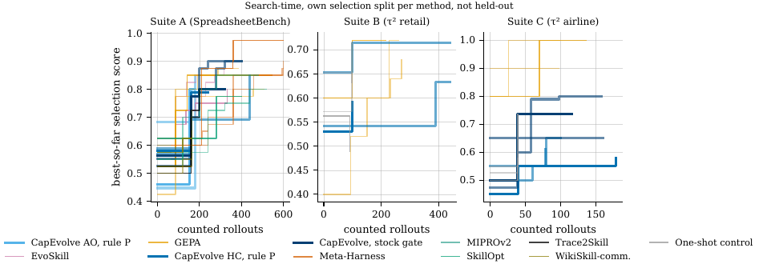
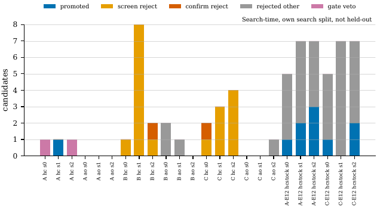
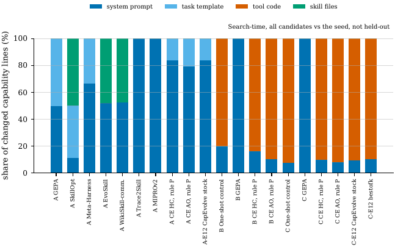
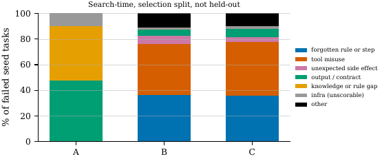
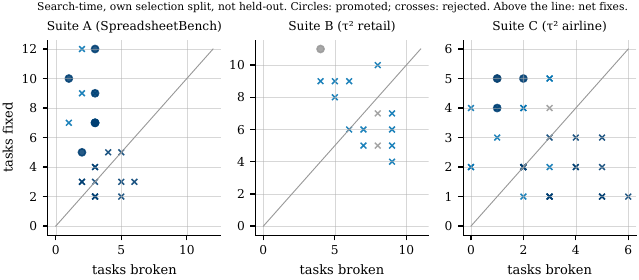
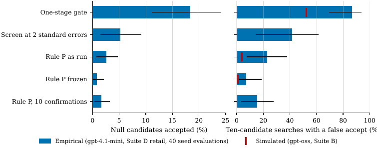
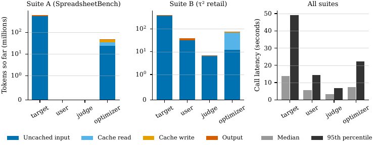
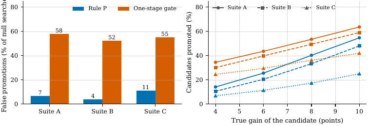
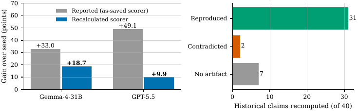

# Results index

Every real result that exists now, with a link and a one-line description. Updated 2026-10-12 16:00 UTC (search-time files as of 15:51 UTC).

**Read this first.**
- No held-out (final-set) score exists for any suite. The final evaluation starts after the search cutoff, 2026-10-13 06:00 UTC. Nothing below is a held-out result.
- Labels: **search-time** = measured on a run's own search or selection split during the search; optimistic, not comparable across methods, and the searches are still running, so these files change. **Held-out** = scored on a sealed final set (none yet). **Real** = computed from run artifacts or logs. **Mock** = seeded placeholder numbers (see the last section); never a finding.
- Source files are regenerated by the scripts in [`analysis/scripts/`](analysis/scripts/). Figures are copied as PNG from the PDFs in [`paper/figures/`](paper/figures/).

## 1. Search-time results (real, search-time)

Snapshot of per-run state is from `analysis/out/searchtime/summary.md` (regenerated in 0bde54c74 after a metrics-converter fix; gateway log up to 2026-10-12 15:51 UTC); rerun `analysis/scripts/searchtime_results.py` for newer numbers.

| File | What it holds |
|---|---|
| [`analysis/out/searchtime/summary.md`](analysis/out/searchtime/summary.md) | Per arm and seed: rollouts used, seed score, champion score on the arm's own split, gain, candidates generated / screened / promoted, whether the returned artifact equals the seed, optimizer tokens, USD, wall hours, run status |
| [`analysis/out/searchtime/runs.csv`](analysis/out/searchtime/runs.csv), [`anytime.csv`](analysis/out/searchtime/anytime.csv) | The same per-run table and best-so-far curves as CSV |
| [`analysis/out/searchtime/gate_by_run.csv`](analysis/out/searchtime/gate_by_run.csv), [`gate_compare.csv`](analysis/out/searchtime/gate_compare.csv) | Per-candidate gate outcomes (screen reject, confirm reject, promote) and gate comparisons |
| [`analysis/out/searchtime/edits_by_arm.csv`](analysis/out/searchtime/edits_by_arm.csv), [`edits_by_candidate.csv`](analysis/out/searchtime/edits_by_candidate.csv) | Which surface each candidate edited (prompt, tool code, template) |
| [`analysis/out/searchtime/infra_by_arm.csv`](analysis/out/searchtime/infra_by_arm.csv) | Infrastructure-error counts by arm |
| [`analysis/out/attrib/summary.md`](analysis/out/attrib/summary.md) | Attribution analyses (search-time, selection split): promotions per search, inert searches, fixed/broke counts per promoted and rejected candidate, edit surface by failure type, shrinkage, cost per point. CSVs in [`analysis/out/attrib/`](analysis/out/attrib/) |

What the search-time files show so far (searches still running, so counts will change):
- CapEvolve with rule P has promoted little. Counts as of 15:51 UTC, search-time: Suite A hill-climb 2 promotions in 15 candidates (1 of 3 searches still returns the seed); Suite B hill-climb 0 of 14 (3 of 3 return the seed); Suite C hill-climb 2 of 16 (1 of 3 returns the seed). Agent-optimize on Suites A, B and C promoted nothing in any seed (Suite A: two native early stops and one token-guard stop). Source: [`attrib/summary.md`](analysis/out/attrib/summary.md), section "Promotions per search and inert searches".
- CapEvolve hill-climb with the stock gate promotes: Suite A (E12A) finished all 3 seeds at 600 rollouts with 7 promotions in 36 candidates and selection-split gains of 0.29 to 0.35; Suite C (E12C) has 3 promotions in 29 candidates so far, with gains of 0.24, 0.00 and 0.32 across seeds. These are selection-split numbers on the split the gate reads and are optimistic. Whether they survive on held-out data is what the final evaluation answers.
- Competitor gains on their own selection splits (for example GEPA on Suite A, 0.33 to 0.38, all three seeds at 600 rollouts) are not comparable with CapEvolve's, because each method selects on a different split.
- HarnessLens on Suite B has no scored candidate yet in the snapshot. Its earlier runs failed on a missing host dependency and are recorded as "not evaluated, environment defect".

Figures (search-time, real):

*Best-so-far score on each arm's own selection split, by counted rollouts. Search-time, real.* PDF: [`paper/figures/searchtime_anytime.pdf`](paper/figures/searchtime_anytime.pdf)

*Gate outcome of each candidate in each CapEvolve search: screen reject, confirm reject, promote. Search-time, real.* PDF: [`paper/figures/searchtime_gate.pdf`](paper/figures/searchtime_gate.pdf)

*Which surface each arm's candidates edit (prompt text, tool code, template). Search-time, real.* PDF: [`paper/figures/searchtime_surface.pdf`](paper/figures/searchtime_surface.pdf)

*Failure types among failed seed tasks, per suite. Search-time, selection split, real.* PDF: [`paper/figures/attrib_failure_types.pdf`](paper/figures/attrib_failure_types.pdf)

*Tasks fixed against tasks broken per candidate (circles promoted, crosses rejected). Search-time, own selection split, real.* PDF: [`paper/figures/attrib_regression.pdf`](paper/figures/attrib_regression.pdf)

LaTeX versions of the tables: [`paper/tables/searchtime_summary_A.tex`](paper/tables/searchtime_summary_A.tex), `_B`, `_C`, [`searchtime_gate.tex`](paper/tables/searchtime_gate.tex), [`searchtime_edits.tex`](paper/tables/searchtime_edits.tex), [`searchtime_infra.tex`](paper/tables/searchtime_infra.tex), and the `attrib_*.tex` files in the same directory.

## 2. E22 null-pool result (real, search-time, Suite D setting)

[`analysis/out/null_pool_replay.md`](analysis/out/null_pool_replay.md). The unmodified seed was evaluated 40 times on tau2 retail opt-49 (target Azure gpt-4.1-mini, 1,960 rollouts) before any candidate existed. Pairs of seed evaluations stand in for null candidates, and the real gate code decides on them. Bootstrap intervals are over evaluations.

| Gate | False accepts per null candidate | Per 10 candidates [95% interval] |
|---|---|---|
| One-stage gate (screen at 1 standard error) | 0.184 | 0.87 [0.70, 0.94] |
| Screen at 2 standard errors | 0.052 | 0.42 [0.14, 0.61] |
| Rule P as run (k 1, 3 confirmations, z 1.282, dmin 0) | 0.026 | 0.23 [0.08, 0.38] |
| Rule P frozen setting (z 2.0, dmin 0.02) | 0.008 | 0.07 [0.01, 0.19] |
| Rule P, 10 confirmations (z 1.645, dmin 0.02) | 0.016 | 0.15 [0.04, 0.27] |

Not tested: the footprint-masked stock gate, false rejects of real improvements (needs true effects), and search dynamics. The simulated one-stage rate for a 10-iteration search was 0.57 ([`sim_promotion.md`](analysis/out/sim_promotion.md)); the empirical rate is higher. Bootstrap script: [`analysis/scripts/null_pool_bootstrap.py`](analysis/scripts/null_pool_bootstrap.py); table [`paper/tables/nullpool.tex`](paper/tables/nullpool.tex).

*Empirical (gpt-4.1-mini, Suite D retail, 40 seed evaluations) against simulated false-accept rates. Search-time, real.* PDF: [`paper/figures/fig_nullpool.pdf`](paper/figures/fig_nullpool.pdf)

## 3. Metering and cost totals (real)

[`analysis/out/metrics/campaign_totals.json`](analysis/out/metrics/campaign_totals.json), built from the gateway call log by [`analysis/scripts/collect_metrics.py`](analysis/scripts/collect_metrics.py). Report: [`analysis/out/metrics/metrics_report.md`](analysis/out/metrics/metrics_report.md) (generated 2026-10-12 13:15 UTC).

| Quantity | Value |
|---|---|
| Model calls logged / errors | 454,715 / 3,505 |
| Tokens, all models (ledger basis, cache reads excluded for Anthropic) | 2.50 billion |
| RITS-served tokens (target models, uncapped by user decision) | 1.70 billion |
| Azure OpenAI direct tokens (uncapped by user decision) | 0.70 billion (167,435 calls) |
| Capped (non-RITS, non-Azure) tokens | 97.2M in this log snapshot; the gateway counter is the authority for the 200M cap (95.4M at 12:50 UTC per [`STATUS.md`](STATUS.md)) |
| Proxy USD, capped bucket (Anthropic list prices) | about $300 |
| Azure list-price USD (not billed) | about $251 |

USD is a proxy from list prices; IBM gateway billing is not visible, and RITS models are unpriced (tokens only), so USD is a lower bound. The log and the gateway `/health` counter differ by a stated reconciliation gap (see the "Reconciliation" section of the report).

Related files in [`analysis/out/metrics/`](analysis/out/metrics/): [`metrics_by_arm.csv`](analysis/out/metrics/metrics_by_arm.csv), [`metrics_by_role.csv`](analysis/out/metrics/metrics_by_role.csv), [`rollout_metrics.csv`](analysis/out/metrics/rollout_metrics.csv), [`bypassed_usage.csv`](analysis/out/metrics/bypassed_usage.csv), [`waste_run_dirs.csv`](analysis/out/metrics/waste_run_dirs.csv), [`error_label_parity.md`](analysis/out/metrics/error_label_parity.md) (adapter error labels against one uniform classifier), [`silent_env_scan.json`](analysis/out/metrics/silent_env_scan.json). Capped-token forecast to the cutoff: [`audit/capped_forecast.md`](audit/capped_forecast.md). Tables: [`paper/tables/cost_so_far.tex`](paper/tables/cost_so_far.tex), [`cost_tokens.tex`](paper/tables/cost_tokens.tex).

*Tokens so far and call latency by role (target, user simulator, judge, optimizer). Real.* PDF: [`paper/figures/fig_roles.pdf`](paper/figures/fig_roles.pdf)

## 4. Gate replay and simulations (real; no held-out data)

| File | What it holds | Type |
|---|---|---|
| [`analysis/out/replay_gates.md`](analysis/out/replay_gates.md) (JSON beside it) | 96 historical candidate decisions from 19 earlier runs replayed under alternative gates. Recorded rule accepts 33; the unmasked one-SE gate would accept 23 (10 decisions differ). Rule P's confirmation stage cannot be replayed: no artifact re-measures candidates on fresh trials | Real, historical artifacts |
| [`analysis/out/sim_gate.md`](analysis/out/sim_gate.md) | False acceptance of null edits by the paired gate at several k, using the real `gate.decide`. At k = 1, about 0.52 probability of at least one false accept in a 10-iteration search | Simulation |
| [`analysis/out/sim_promotion.md`](analysis/out/sim_promotion.md) | One-stage gate against rule P: about 0.57 against 0.04 to 0.09 false-promotion probability per 10-iteration search, with confirmation cost | Simulation |
| [`analysis/out/sim_budget.md`](analysis/out/sim_budget.md), `_A`, `_B`, `_C`, `_B_sel25`, `_C_sel10` | Rule P operating points at the real budgets and observed task difficulty; the basis for the chosen operating point (k 1, 3 confirmations, z 1.282) | Simulation |
| [`analysis/out/sim_footprint.md`](analysis/out/sim_footprint.md), [`sim_posterior.md`](analysis/out/sim_posterior.md), [`sim_stderr.md`](analysis/out/sim_stderr.md) | Footprint masking accept rates; the reward-gated rule and its hard-coded standard-error floor; the combined standard error against the two possible estimands | Simulation |
| [`analysis/out/mde_observed.md`](analysis/out/mde_observed.md), [`sim_mde.md`](analysis/out/sim_mde.md) | Minimum detectable effects from the seed artifact's observed variance on the search splits (Suite A within-task variance 0.088; B 0.148; C 0.124) and from assumed placeholders | Real inputs / simulation |

*Candidates promoted and false promotions of null searches, rule P against the one-stage gate, by suite. Simulation (real gate code, simulated rewards).* PDF: [`paper/figures/fig_rulep.pdf`](paper/figures/fig_rulep.pdf)

## 5. Audits (real)

| File | What it holds |
|---|---|
| [`audit/algorithm_audit.md`](audit/algorithm_audit.md), [`audit/defects.csv`](audit/defects.csv) | Source audit of the repository at the base commit with file and line references; defects D01 onward (footprint masking, one-SE gate false accepts, validation-split reuse, test seal per run directory, optimizer isolation). Reproduction scripts in [`audit/repro/`](audit/repro/). Drafted issues in [`audit/issue_drafts/`](audit/issue_drafts/) |
| [`audit/historical_results.md`](audit/historical_results.md), [`recomputed_numbers.csv`](audit/recomputed_numbers.csv), [`exposure_ledger.csv`](audit/exposure_ledger.csv) | Recomputation of 40 historical claims from 20 downloaded run artifacts. SpreadsheetBench gains split by scorer: Gemma +33.0 as saved against +18.7 recalculated; GPT-5.5 +49.1 against +9.9. Exposure ledger marks the old test sets as development-exposed. Drafted issues in [`audit/provenance_issue_drafts/`](audit/provenance_issue_drafts/) |
| [`audit/gold_access_scan.md`](audit/gold_access_scan.md) | Gold-file access scan of retained SpreadsheetBench artifacts: no evidence of gold access on the agent side in 2,049 retained rollouts (absence of evidence, not clearance); optimizer-side gold access documented in at least 6 earlier runs |
| [`audit/metering_routing_audit.md`](audit/metering_routing_audit.md) | Metering, routing and credential-exposure audit of Suites A to C: no optimizer usage bypassed the gateway (2026-10-11 20:40 UTC snapshot) |
| [`audit/silent_env_failures.md`](audit/silent_env_failures.md) | Silent environment failures across all arms (2026-10-12 09:50 UTC snapshot), including the HarnessLens bubblewrap defect |
| [`audit/fresh_test_candidates.md`](audit/fresh_test_candidates.md), [`sb912_residual_exposure.csv`](audit/sb912_residual_exposure.csv) | Exposure audit of candidate fresh final sets and of the SpreadsheetBench-912 residual pool |
| [`audit/artifact_manifest.json`](audit/artifact_manifest.json) | Hashes of the 6.6k+ downloaded historical artifacts |

*Left: reported against recalculated-scorer gain over seed for the old Gemma and GPT-5.5 results. Right: outcome of 40 historical claims recomputed (reproduced, contradicted, no artifact). Real, historical artifacts.* PDF: [`paper/figures/fig_audit.pdf`](paper/figures/fig_audit.pdf); table [`paper/tables/audit.tex`](paper/tables/audit.tex)

## 6. Not results yet

These exist in [`paper/`](paper/) as mock-number placeholders and carry a PLACEHOLDER watermark or `mock` macros. They are generated from seeded random values to fix layout, and say nothing about the methods:
- Figures: `fig_anytime`, `fig_forest`, `fig_contrast`, `fig_ablate`, `fig_pareto`, `fig_families`.
- Tables: main comparison on Suites A, B and C, per-seed tables, Suite D and E tables, ablation, decomposition, equivalence rows, the abstract result sentence.
- N* per suite.

They are replaced by real tables and figures after the final evaluation (`make all MODE=real` in `paper/`).
